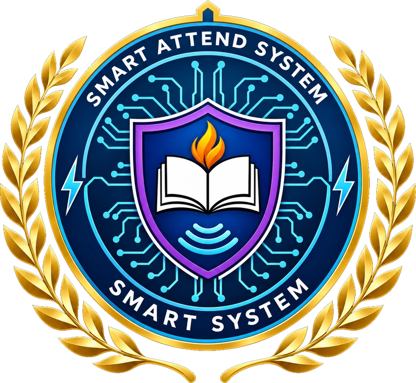
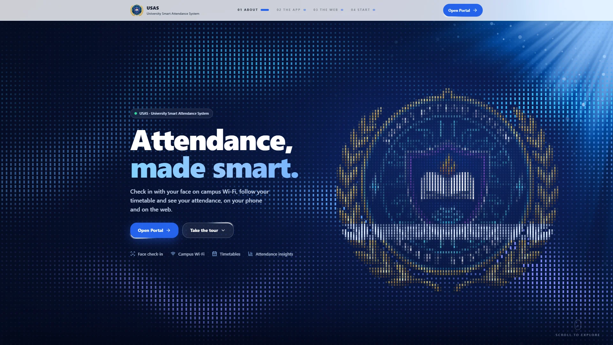
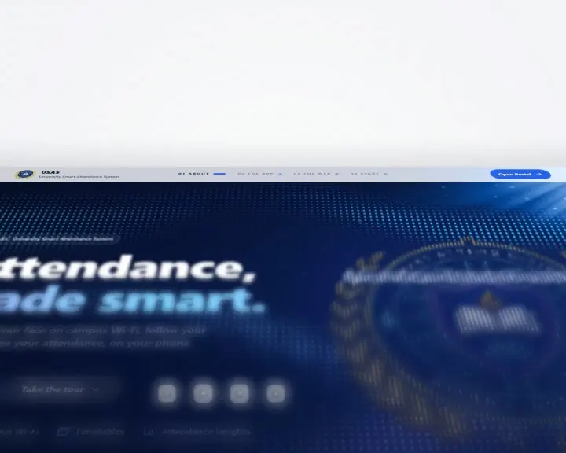
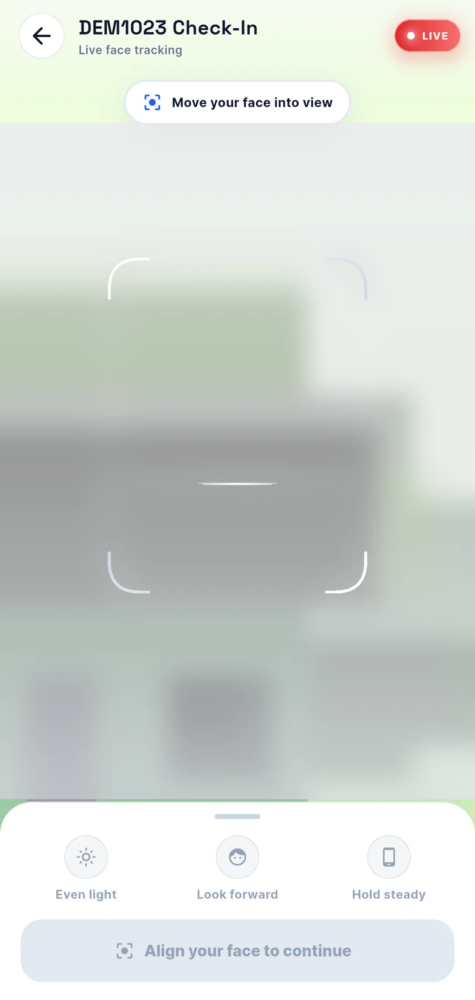
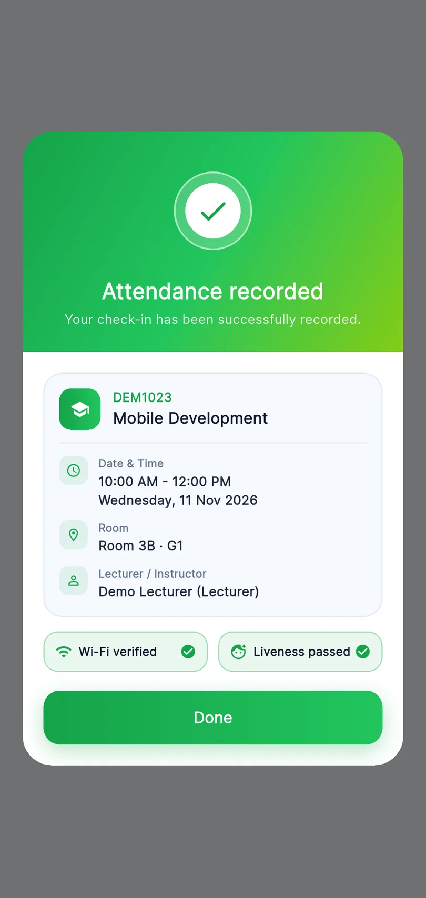
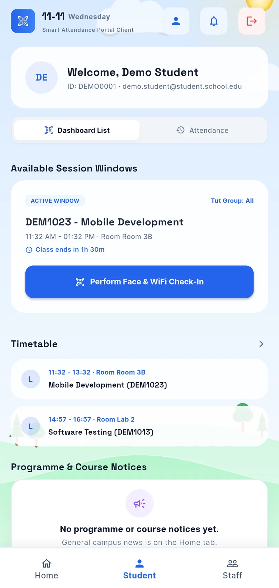
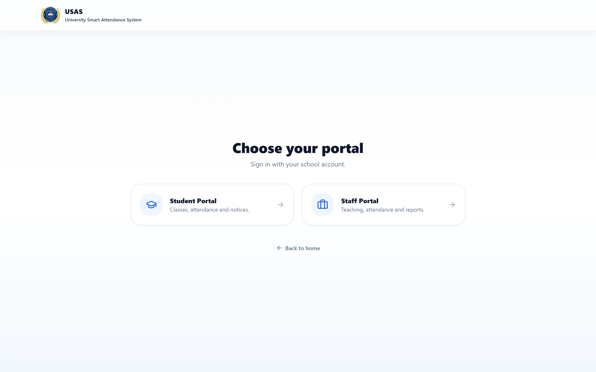
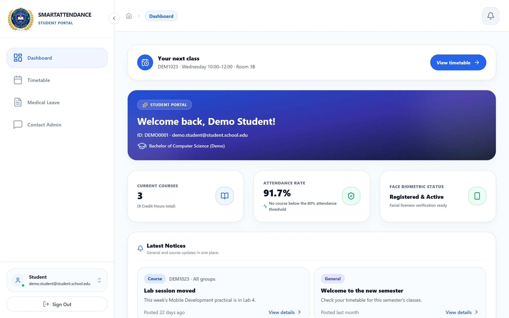
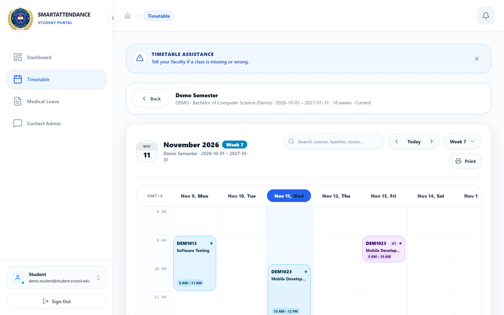
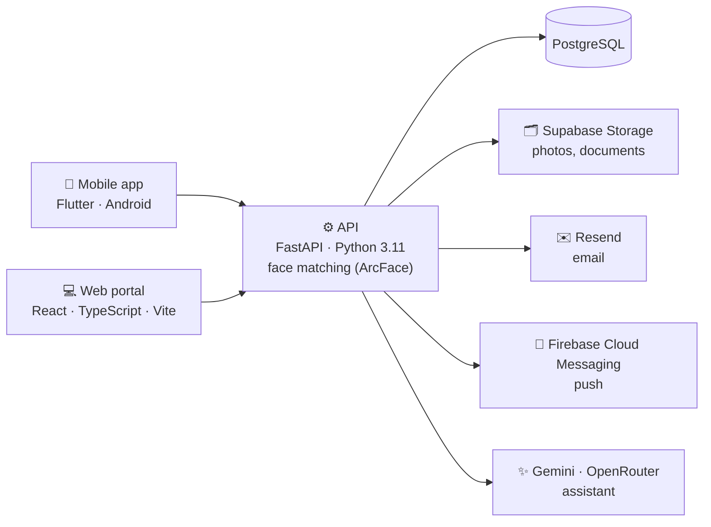

<h1 align="center">
  <a href="https://smartsystem.live"></a>
  <br />
  USAS
</h1>

<p align="center"><strong>University Smart Attendance System</strong></p>

<p align="center">
  <a href="https://github.com/LowYoongQian/fyp/releases/latest"></a>
  <a href="https://github.com/LowYoongQian/fyp/releases"></a>
  <a href="https://github.com/LowYoongQian/fyp/actions/workflows/azure-backend-deploy.yml"></a>
  <a href="https://github.com/LowYoongQian/fyp/actions/workflows/azure-static-web-apps-red-sand-0c0d09f00.yml"></a>
  
</p>

<p align="center">
  
  
  
  
  
  
  
</p>

<p align="center">
  <strong>Attendance, made smart.</strong><br />
  Students check in with their face on campus Wi-Fi, follow their timetable and see their attendance, on their phone and on the web.<br />
  Lecturers open a class and see who came; administrators run programmes, courses and semesters, all in one system.
</p>

<h3 align="center">
  <a href="https://smartsystem.live"><ins>Visit the website</ins></a> ·
  <a href="https://smartsystem.live/portal"><ins>Open the portal</ins></a> ·
  <a href="https://github.com/LowYoongQian/fyp/releases/latest"><ins>Download the Android app</ins></a>
</h3>

<p align="center">
  
</p>

## See it in 15 seconds

<p align="center">
  <a href="https://smartsystem.live"></a>
</p>

## Features

<table>
<tr>
<td width="50%" valign="middle">

### Face check-in on campus

Students check in from their own phone. The app asks for a blink and a nod to prove a real person is there, the server matches the face against the one they registered, and the check-in only counts on the campus network, during the class.

</td>
<td width="50%" align="center">
  
</td>
</tr>
<tr>
<td width="50%" valign="middle">

### Recorded on the spot

The moment the face and the network are confirmed, the attendance is recorded and the student sees the confirmation straight away.

</td>
<td width="50%" align="center">
  
</td>
</tr>
<tr>
<td width="50%" valign="middle">

### Your day at a glance

The student dashboard shows the classes open for check-in, today's timetable and the latest announcements.

</td>
<td width="50%" align="center">
  
</td>
</tr>
<tr>
<td width="50%" valign="middle">

### One portal for students and staff

The web portal has a sign-in for students and one for staff (lecturers and administrators), with two-step verification, recovery codes and a list of signed-in devices.

</td>
<td width="50%">
  
</td>
</tr>
<tr>
<td width="50%" valign="middle">

### Attendance and notices on the web

Students see their attendance for the semester, the classes that need them next and every notice, on any computer.

</td>
<td width="50%">
  
</td>
</tr>
<tr>
<td width="50%" valign="middle">

### Timetables and semesters

Every class of the current semester in a weekly timetable. Administrators plan programmes, courses, class groups and semesters; lecturers see only their own classes.

</td>
<td width="50%">
  
</td>
</tr>
</table>

### And more

<table>
<tr>
<td width="50%" valign="top">

- **Staff analytics**: weekly attendance trends, a target line, attendance by weekday and by class group, and the students at risk.
- **Warning emails** to students whose attendance falls too low.
- **Notifications** in the app and as push messages, with quiet hours.
- **Medical leave** submitted with a document, screened automatically and reviewed by an administrator.

</td>
<td width="50%" valign="top">

- **AI assistant** that answers questions about classes and attendance.
- **Announcements** with attachments.
- **Audit log** of sign-ins and changes, with where they came from.
- **Eleven languages**, including right-to-left Arabic, and on the web light, dark, system or day-and-night themes.

</td>
</tr>
</table>

## How it fits together



| Part | Folder | Built with | Runs on |
| --- | --- | --- | --- |
| API | [`fyp-backend`](fyp-backend) | FastAPI, SQLAlchemy, Alembic, DeepFace (ArcFace), TensorFlow | Azure, from the [`Dockerfile`](Dockerfile) |
| Web portal and home page | [`fyp_web`](fyp_web) | React 19, TypeScript, Vite, Tailwind CSS, Motion, Recharts | Azure Static Web Apps, [smartsystem.live](https://smartsystem.live) |
| Mobile app | [`fyp_flutter`](fyp_flutter) | Flutter, ML Kit face detection, camera, Firebase Messaging | Android APK on [Releases](https://github.com/LowYoongQian/fyp/releases/latest) |

## Getting started

### Requirements

- **Python 3.11** exactly: TensorFlow 2.14, which DeepFace needs for ArcFace, has no wheels for 3.12 or later.
- **Node.js 18** or later for the web portal.
- **Flutter SDK** (Dart 3.11) for the mobile app.
- A **PostgreSQL** database.

### API

```bat
cd fyp-backend
copy .env.example .env    :: then fill in DATABASE_URL, JWT_SECRET_KEY and the services you use
setup_backend.bat         :: creates the virtual environment, installs requirements, checks the imports
run_backend.bat           :: applies the Alembic migrations, then starts uvicorn on port 8003
```

`stop_backend.bat` frees the port if it stays busy after Ctrl+C.

### Web portal

```bat
cd fyp_web
copy .env.example .env    :: VITE_API_BASE_URL=http://localhost:8003
setup_web.bat
run_web.bat               :: http://127.0.0.1:5173
```

### Mobile app

```bash
cd fyp_flutter
flutter pub get
flutter run --dart-define=API_BASE_URL=http://10.0.2.2:8003    # your local API, from the emulator
```

Without `API_BASE_URL` the app uses the hosted API at `https://api.smartsystem.live`.

### Good to know

- The port is set once, as `BACKEND_PORT=8003` in `fyp-backend/.env`; keep the web and app settings in step with it.
- Database schema changes go through Alembic migrations only.
- Check-in is accepted only from the campus network, and the API decides that from the request's own address (see `TRUSTED_PROXY_CIDRS` in `.env.example` when it runs behind a proxy).

## Releases and deployment

- **Android**: pushing a version tag (`v1.2.3`) builds the APK and publishes it on [GitHub Releases](https://github.com/LowYoongQian/fyp/releases).
- **API**: changes to `fyp-backend` on `main` are built into a container and deployed to Azure.
- **Web**: changes on `main` are built and deployed to Azure Static Web Apps.

The full history of changes is in the [changelog](CHANGELOG.md).

## About

USAS is a final year project by [LowYoongQian](https://github.com/LowYoongQian). Every screen shown here uses sample data, never a real account.

No open-source license has been chosen, so all rights are reserved by the author.
